# RFC: Host channel and tenant operations as sequences

| Field   | Value                                                                                                                                     |
| ------- | ----------------------------------------------------------------------------------------------------------------------------------------- |
| Status  | Draft (2026-11-23)                                                                                                                        |
| Scope   | Review only; the code as built at control-plane bdd61a1 plus control-plane PR 149 (open), supervisor 8d051d3, channel protocol version 37 |
| Related | [channel.tsp](../../typespec/lib/channel.tsp), [tenant-api.tsp](../../typespec/lib/tenant-api.tsp)                                        |

## Summary

This document draws every host operation of the control plane as one sequence diagram. Each diagram shows who writes which row or object, and in what order. The host keeps every frame it sends in `channel.json` until the control plane acks it. The control plane acks a host frame only after the frame's effect is stored. Each diagram makes that order visible, and the text under it names every place where the code differs from the design.

The diagrams describe the code as built. Where it differs from the design, one sentence under the diagram says so. The appendix lists the rows each operation writes, with the measured figure next to the row budget.

## Reading the diagrams

Every diagram has the same participants in the same order: the supervisor on the host, the HostChannel Durable Object, the Tenant Durable Object, R2 and D1. TenantMetrics appears where telemetry is written. The Worker appears last when a client request starts the operation.

The HostChannel keeps two kinds of state. Its socket attachment holds the connection phase, the cursor (the last host `seq` applied on this connection), `boxCapacity` and the frame-rate window. A `Note over H` shows an attachment change. The `ledger` row holds the outbound frames the host has not acked. A self-arrow `H->>H: ledger row` shows a write to that row.

A shaded box around Tenant self-arrows is one SQL transaction. A Tenant self-arrow outside a box commits on its own. An arrow to R2 or D1 is a write or read of the object or row it names. An arrow that carries a credential, a presigned URL or a token names it in the label.

## 1. Hello and Welcome

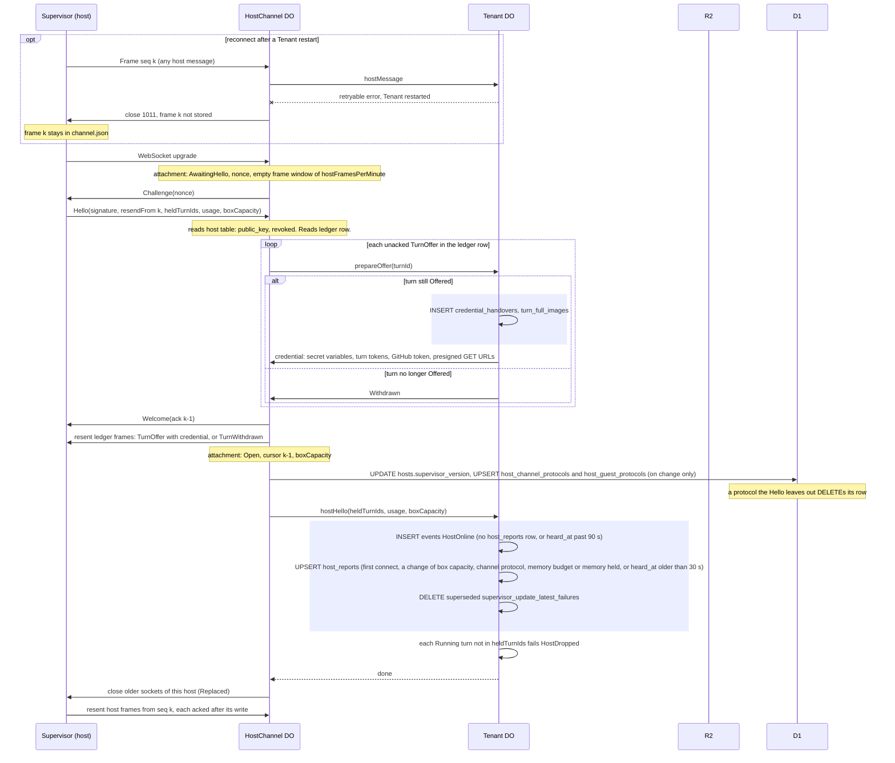

On a first connect the Tenant inserts the `host_reports` row and appends HostOnline, and Welcome goes out alone. The cursor comes from `resendFrom` alone. Hello judges only Running turns; Offered turns wait for the Heartbeat grace in section 2.

The supervisor resends its withheld frames at most half the frame limit per tick, so a long backlog stays under the rate limit on reconnect.

Code and design differ in three places. Welcome and the resent frames go out before the D1 and Tenant writes of Hello. Welcome still carries `ack`, which the protocol text says version 37 leaves out; the supervisor ignores it at 37. Each resent offer mints fresh credentials and writes one more `credential_handovers` row.

## 2. Heartbeat and reconcile

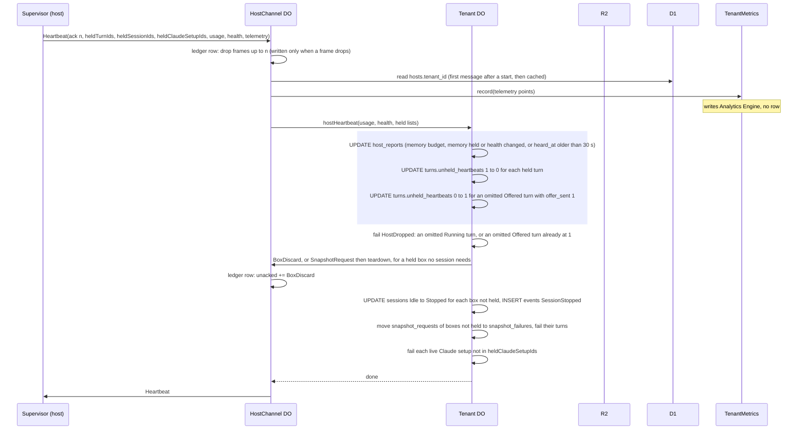

The host sends a Heartbeat at the interval set in its runtime configuration. The reply Heartbeat leaves the HostChannel after every write above. A report that matches the stored one writes no row. One row lands in `host_reports` about every 40 seconds, when `heard_at` passes 30 seconds.

`heldTurnIds` names the turns the host runs, every turn named by an unacked host frame, and every offer received and not yet started. An offer the host never took fails HostDropped on the second Heartbeat that omits it. Turns that wait on a `snapshot_requests` row are left out of reconcile.

Code and design differ in four places. Only the Heartbeat `ack` drops outbound frames; the `ack` on a host frame is ignored. A Heartbeat updates `host_reports` but never creates it, so only Hello inserts the row. A telemetry batch TenantMetrics refuses is logged and dropped. The protocol text says an omitted session fails its Running turn BoxLost; the code stops only Idle sessions and leaves Running turns to `heldTurnIds`.

## 3. TurnOffer, TurnClaim and TurnClaimed

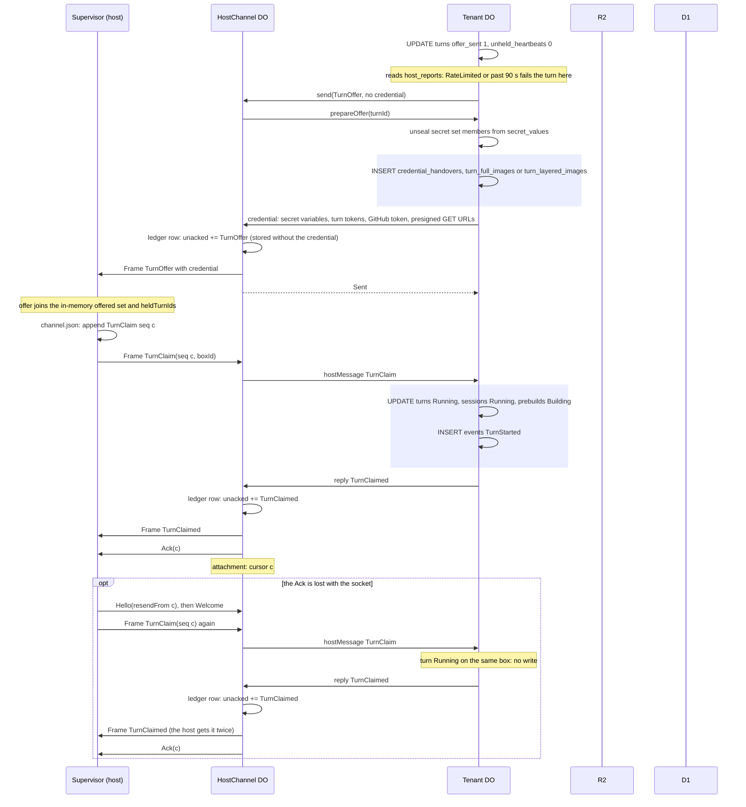

With no open socket the HostChannel answers Offline, and the Tenant fails the turn Undelivered at once. A TurnClaim from another host for this turn gets TurnWithdrawn. A TurnClaim for a turn that already ended gets TurnWithdrawn, plus BoxDiscard when its session is Stopped.

The ledger row stores the offer without the credential. Every send to the host, including a resend at Welcome, calls `prepareOffer` again and mints a fresh credential.

Code and design differ in one place: the Tenant's offer awaits `prepareOffer` before the ledger append, where the design appends before any await. A HostChannel restart in that window rejects the send, and the turn fails Undelivered.

## 4. TurnLines to an R2 chunk

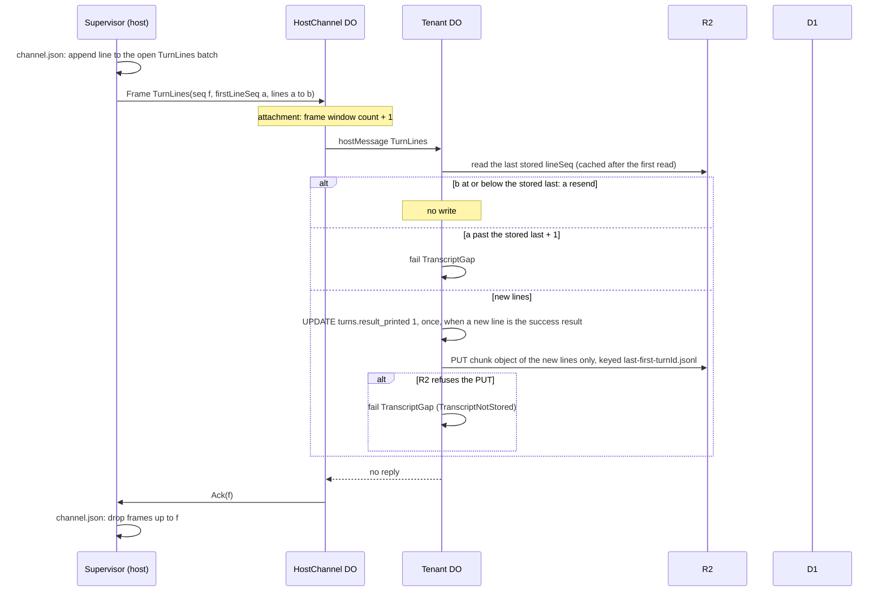

A TurnLines frame writes no Durable Object row, except `result_printed` once per turn. A resend that overlaps stored lines writes only the lines past the stored last, so a chunk key never holds a line twice. A turn that is not Running ignores the frame and the frame is still acked.

`result_printed` commits before the R2 PUT. A PUT that fails after it leaves the flag set on a turn that then fails TranscriptGap, and the turn ends Failed either way.

## 5. TurnComplete and TurnFailed

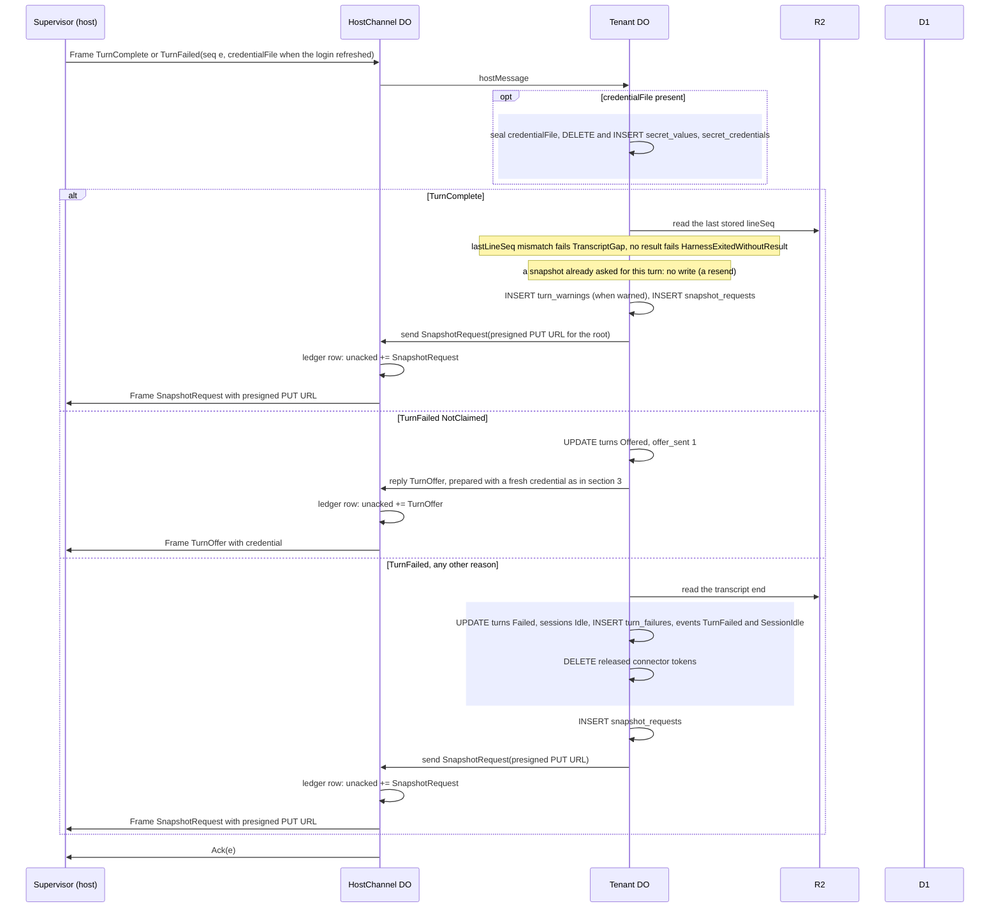

TurnComplete does not complete the turn. It asks for a snapshot, and the turn turns Completed only when SnapshotDone stores it (section 6). A failed turn also asks for a snapshot, so its session keeps the work done so far. TurnFailed HostUpdating moves an Offered turn, or a Running turn with no lines, to another host.

Every write above lands before the Ack. A resent TurnComplete finds its `snapshot_requests` row and writes nothing. A resent TurnFailed finds the turn already Failed and writes nothing.

## 6. Snapshot upload

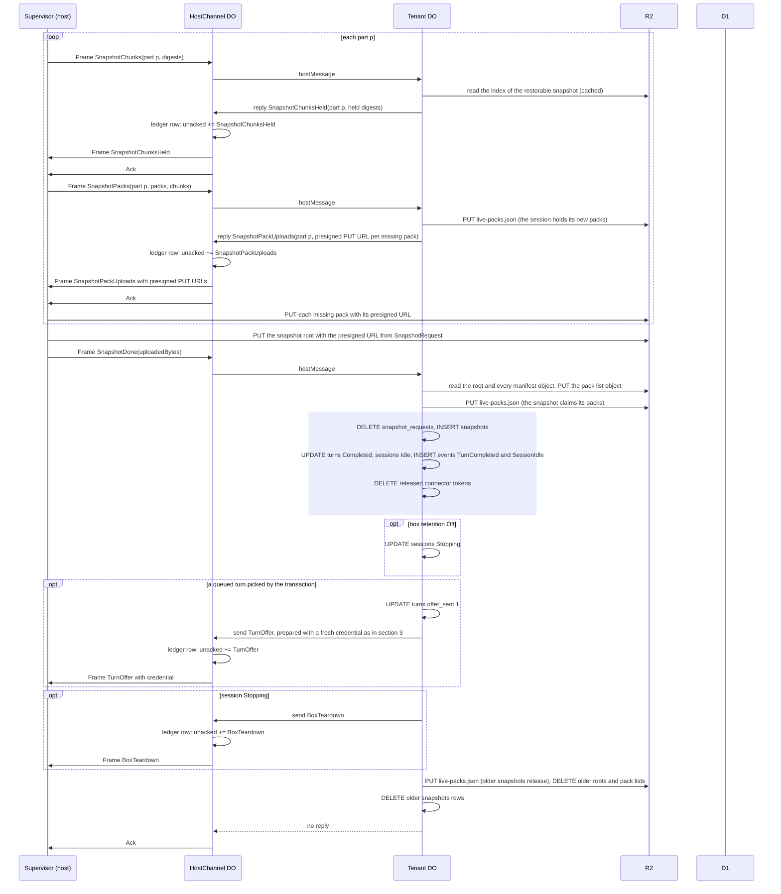

Each part writes the `ledger` row twice, once per reply, and the next Heartbeat `ack` writes it once more. A stored snapshot writes the same Tenant rows for one chunk or 100000, because chunks and packs live in R2 objects. A resent SnapshotChunks or SnapshotPacks returns the same answer; a resent SnapshotDone finds no `snapshot_requests` row and writes nothing.

SnapshotFailed, or a SnapshotDone whose root, manifest or packs fail the checks, moves the request to `snapshot_failures` and fails the turn SnapshotNotStored.

Code and design differ in one place: `live-packs.json` is written with a plain PUT, where the design asks for an etag-conditional PUT.

## 7. BoxGone and eviction to make room

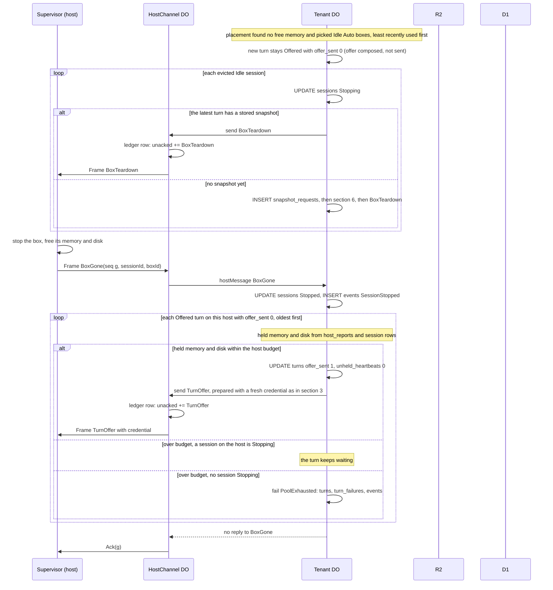

The offer of the waiting turn is stored and sent before the Ack of the BoxGone that made room for it. The same loop runs after every Heartbeat reconcile, so a waiting turn is offered as soon as the session rows and the host report leave room.

BoxTeardownFailed inserts `stop_failures` and returns the session to Idle. Its box still holds memory and no session is Stopping, so the next Heartbeat fails the waiting turn PoolExhausted. A teardown that never answers keeps its session Stopping, and the waiting turn waits for its BoxGone.

Code and design differ on main: without PR 149, BoxGone re-runs only the evicted session's own queue, so the waiting turn's offer is never sent.

## 8. Frame-rate limit

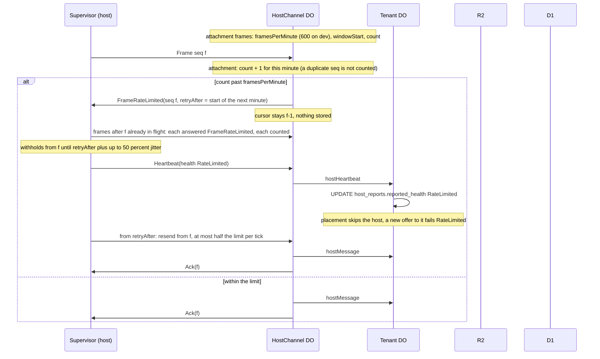

The window lives in the socket attachment. It survives hibernation; a new socket starts a fresh window. Running turns keep running through a refusal. The host reports RateLimited for one minute after its last FrameRateLimited, and that `host_reports` update is the one row a refusal writes.

The rate check runs before the gap check. A frame past a gap that arrives after `retryAfter` closes the connection, and the next Hello resends from the oldest unacked frame.

Code and design differ in two places. A refused frame counts against the minute it arrives in, where the protocol text says it counts nothing. A new offer to a host that reports RateLimited fails the new turn RateLimited, where the design pauses offers without failing them.

## 9. Host revoke

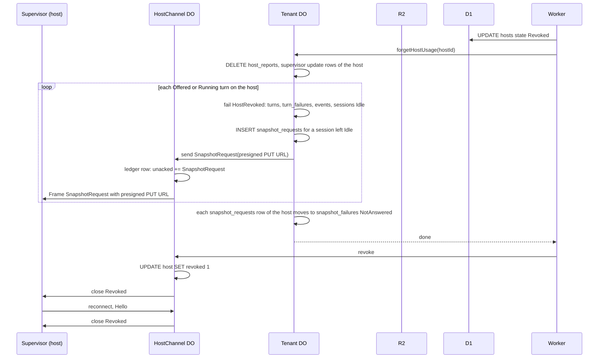

Revoke runs from the Worker in three steps: D1, then the Tenant, then the HostChannel. The host learns of it only from the close. No TurnCancel is sent, and credentials already handed over stay valid until they expire.

Code and design differ in one place: failing a Running turn asks its box for a snapshot, so a SnapshotRequest reaches the ledger row and the open socket before the close, and stays unacked in the ledger row.

## 10. Session start and placement

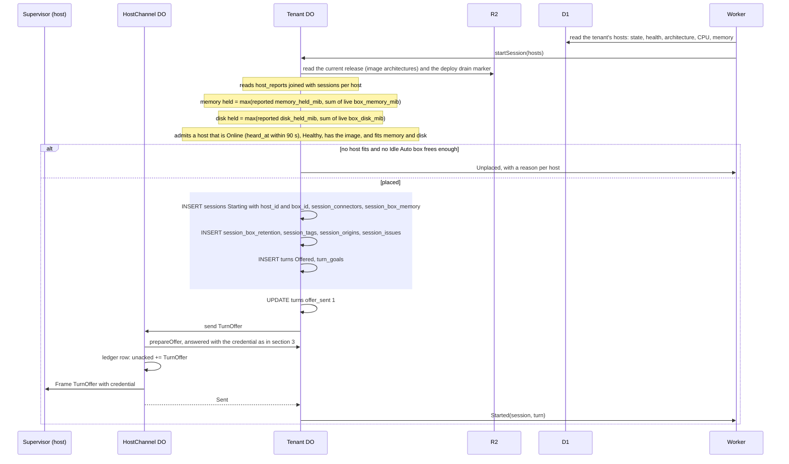

A live box belongs to a Starting, Running, Idle or Stopping session. The session row gets its `host_id` and `box_id` in the same transaction as the turn, before the offer, so the next placement in the same Tenant already counts the box. A host with no `host_reports` row reads NotOnline. When eviction is needed, the offer waits for BoxGone as in section 7.

Placement admits on memory and disk only. Free box slots (`box_capacity` less Starting, Running, Idle and Stopping boxes) and load rank the admitted hosts but never refuse one. The disk check applies only when the host reports disk held above zero.

## 11. Turn sent to an existing session

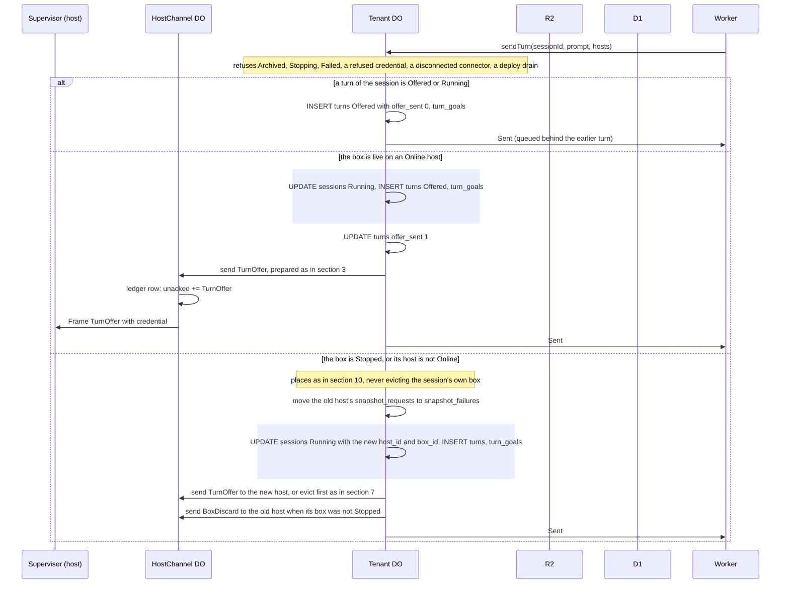

A queued turn is offered when the turn before it ends: the transaction that ends that turn picks it, and the offer goes out after the commit. A session whose completed turns have no stored snapshot is refused as Stranded when it has to move host, because the new box cannot restore their work.

Excluding the session's own box from eviction comes from PR 149; on main a send picks the session's own Idle box as the box to evict.

## FAQ

**Why does the host get TurnClaimed twice after a lost Ack?**
The control plane cannot tell a resent TurnClaim from a lost reply, so it answers again with no write.

**Can a turn wait forever for room?**
Yes, while a teardown never answers. Its session stays Stopping, and the waiting turn waits for a BoxGone that never comes.

**Where do credentials live after an offer?**
In box memory on the host. The `ledger` row stores the offer without them, and each resend mints new ones.

## Appendix: rows per operation

Rows count Durable Object SQL rows and index entries, as the scenario tests and the dev metrics count them. "Idle" is one host with no turn for 10 minutes. Measured figures come from the `test/scenarios` row tests at bdd61a1 and from the dev row counts recorded with them.

| Operation                          | Rows written per store                                                                                                                | Idle 10 min                      | Measured                                                                             | Row budget                |
| ---------------------------------- | ------------------------------------------------------------------------------------------------------------------------------------- | -------------------------------- | ------------------------------------------------------------------------------------ | ------------------------- |
| Hello                              | D1: 0 unchanged. HostChannel: 0. Tenant: `host_reports` 0 or 1, `events` 0 or 1, plus one `credential_handovers` row per resent offer | 0                                | not measured                                                                         | at most 1                 |
| Heartbeat                          | HostChannel: `ledger` 0, or 1 when `ack` drops a frame. Tenant: `host_reports` 0 or 1. TenantMetrics: 0                               | Tenant at most 20, HostChannel 0 | test: at most 20 Tenant, 0 HostChannel; dev: 46 for two hosts                        | 20 Tenant, 0 HostChannel  |
| TurnOffer to TurnClaimed           | HostChannel: `ledger` 2. Tenant: `turns`, `credential_handovers`, image row, then `turns`, `sessions`, `events` at claim              | 0                                | within the turn below                                                                | within the turn below     |
| TurnLines                          | Tenant: 0, plus `result_printed` once per turn. R2: one PUT per frame. HostChannel: 0                                                 | 0                                | test: rows do not grow with lines or chunks                                          | 0 rows, one PUT per frame |
| TurnComplete                       | Tenant: `snapshot_requests` 1. HostChannel: `ledger` 1                                                                                | 0                                | within the turn below                                                                | within the turn below     |
| Stored snapshot                    | HostChannel: `ledger` 2 per part. Tenant: fixed per snapshot. R2: `live-packs.json`, pack list, packs, root                           | 0                                | test: at most 20 Tenant, the same for 1 or 100000 chunks; failed snapshot at most 25 | no separate budget        |
| One turn, offer to stored snapshot | sum of the rows above                                                                                                                 | 0                                | test and dev: 53 Tenant, 5 HostChannel                                               | 24 Tenant, 10 HostChannel |
| BoxGone after eviction             | Tenant: `sessions` 2, `events` 1, then the offer rows. HostChannel: `ledger` 2                                                        | 0                                | not measured                                                                         | no separate budget        |
| Frame-rate limit                   | HostChannel: 0 (attachment only). Tenant: `host_reports` 1 when the reported health turns RateLimited                                 | 0                                | test: no row per refused frame                                                       | 0                         |
| Host revoke                        | D1: `hosts` 1. Tenant: `host_reports` 1 and the failure rows per turn. HostChannel: `host` 1                                          | 0                                | not measured                                                                         | no separate budget        |
| Session start                      | Tenant: `sessions` and its side tables, `turns`, then the offer rows. HostChannel: `ledger` 1                                         | 0                                | within the turn above                                                                | within the turn above     |
| Turn to an existing session        | Tenant: `sessions`, `turns`, then the offer rows. HostChannel: `ledger` 1                                                             | 0                                | within the turn above                                                                | within the turn above     |

The idle figure is inside the row budget of 100 rows per 10 minutes, and the Tenant's 30-second `host_reports` refresh makes up all of it. One turn writes 53 Tenant rows against a row budget of 24; session creation, credential handovers, layered image rows and snapshot request rows make up the difference.
